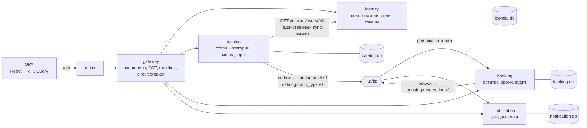
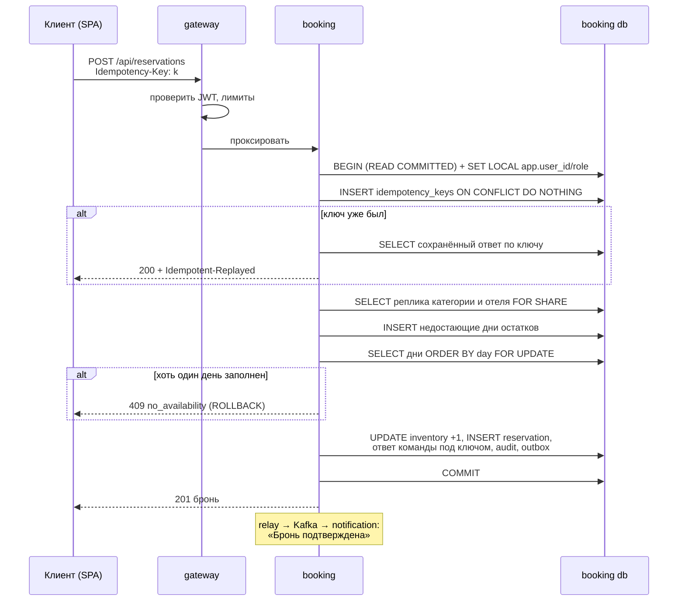
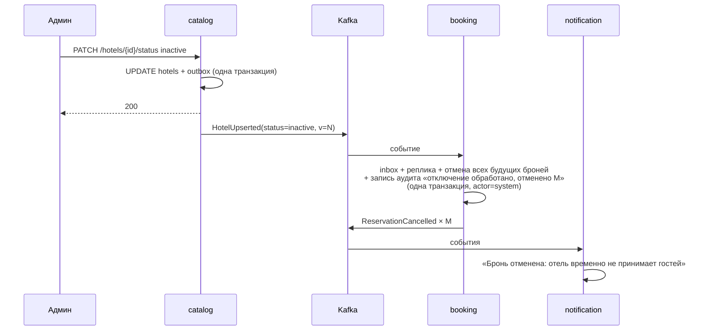

# TourFlow — архитектура

Эталон-сервис бронирования отелей для турфирмы. Одна предметная область сквозь три дисциплины:

| Дисциплина | Что закрывает TourFlow |
|---|---|
| **Проектирование корпоративных приложений** (Заманов Е. А.) | гранулярность сервисов, владение данными, саги, outbox, circuit breaker, DDD, гексагональная архитектура |
| **Распределённые хранилища данных** (Заманов Е. А.) — курсовой проект | конкурентное резервирование, идемпотентность, RLS, append-only аудит, индексы, изоляция транзакций |
| **Разработка SPA** (Клеблеева Е. Р.) — курсовой проект | React 18 + TS + webpack, RTK Query, роли, защищённые маршруты, 15 экранов |

## Предметная область

- **Отель** — граница арендатора (tenant). У отеля есть менеджеры.
- **Категория номеров** — «Стандарт двухместный, 12 штук». Это ресурс с вместимостью `total_rooms`, а не конкретный номер 305: номер назначает отель при заселении.
- **Бронь** — категория на полуинтервал дат `[check_in, check_out)`. День выезда свободен для следующего гостя.
- **Остаток** — сколько номеров категории продано на конкретную ночь.

Роли:

| Роль | Может |
|---|---|
| Клиент | искать, бронировать, отменять свою бронь до дня заезда, видеть историю, получать уведомления |
| Менеджер отеля | редактировать свои отели и категории, видеть и отменять брони своих отелей (с причиной), читать аудит |
| Администратор | всё, что менеджер, для любых отелей + создавать отели, включать/выключать их, назначать менеджеров, выдавать роли. **Не может бронировать.** |

## Сервисы



| Сервис | Порт | Владеет данными | Публикует | Потребляет |
|---|---|---|---|---|
| gateway | 8080 | — | — | — |
| identity | 8081 | users, refresh_tokens | — | — |
| catalog | 8082 | hotels, hotel_managers, room_types | HotelUpserted, RoomTypeUpserted | — |
| booking | 8083 | inventory, reservations, idempotency_keys, audit_log | ReservationConfirmed, ReservationCancelled | события каталога |
| notification | 8084 | notifications | — | события брони |

## Ключевые потоки

### Бронирование (синхронно, одна локальная транзакция)



### Отключение отеля (хореография, компенсация)



## Устройство сервиса (гексагональная архитектура)

```
internal/<service>/
  domain/      сущности, value objects, инварианты — без зависимостей от БД/HTTP
  app/         сценарии (use cases) + порты (интерфейсы Store, Directory, Tx)
  store/       адаптер PostgreSQL (реализует порты)
  api/         адаптер HTTP (DTO ↔ домен, коды ошибок)
  migrations/  SQL, встроены в бинарник
cmd/<service>/main.go   ручная сборка зависимостей (без DI-контейнера)
internal/platform/       общая инфраструктура: http, auth, pg, messaging, resilience
```

Архитектурный тест (`backend/arch_test.go`) запрещает сервисам импортировать друг друга: общий код — только `platform`.

## Контракт событий (РХД ПР-4)

Конверт `messaging.Envelope` общий для всех топиков. Назначение полей:

| Поле | Назначение |
|---|---|
| `event_id` | UUID события. **Ключ дедупликации** у потребителя (`processed_events`). Повторная доставка приходит с тем же `event_id`. Дублируется в колонке `outbox.event_id` (UNIQUE). |
| `event_type` | `HotelUpserted`, `RoomTypeUpserted`, `ReservationConfirmed`, `ReservationCancelled`. По нему потребитель выбирает обработчик; неизвестный тип пропускает. |
| `schema_version` | версия структуры `payload`. Совместимые изменения — только добавление полей (потребители читают лишь нужные, T11). Несовместимые — новый топик `.v2`. Потребитель знает старшую понятную ему версию (`messaging.MaxSchemaVersion`): сообщение с незнакомой версией он не обрабатывает «как понял», а откладывает в DLQ исходными байтами (`TestContractEvolutionAndQuarantine`). |
| `occurred_at` | время создания события (UTC). Только для диагностики: порядок по нему не определяется. Обязательное: событие с нулевым временем — нарушение контракта издателем, потребитель откладывает его в DLQ. |
| `aggregate_id` | id отеля, категории или брони. Он же ключ сообщения Kafka: события одного агрегата идут в одну партицию. |
| `aggregate_version` | версия агрегата после изменения. Потребитель применяет событие, только если версия больше сохранённой: порядок между пачками нескольких ретрансляторов не гарантирован (T20, T22). |
| `producer` | сервис-издатель. |
| `request_id` | id исходного HTTP-запроса: связывает событие с запросом в логах (T79). |
| `payload` | снимок агрегата целиком, а не дельта (T10): одно событие восстанавливает состояние реплики. |

**Команда «забронировать»** (`POST /api/reservations` с `Idempotency-Key`) в одной транзакции пишет: бизнес-объект (бронь и строки остатков), ответ команды (`idempotency_keys.response` — бронь в том виде, в каком её получил клиент), запись аудита и событие в outbox. Повтор с тем же ключом возвращает сохранённый ответ, даже если бронь с тех пор отменили.

**Алгоритм потребителя при повторной доставке** (`booking.HandleCatalogEvent`, `notification.Deliver`):

1. Разобрать конверт. Битый конверт или негодные значения — постоянная ошибка: сообщение уходит в `<topic>.dlq` с причиной в заголовках, и только после успешной публикации в DLQ фиксируется offset. Временная ошибка (база недоступна, тайм-аут блокировки) в DLQ не уходит: повтор с паузой до 5 с, пока не получится (T27).
2. Открыть транзакцию с контекстом RLS `system`.
3. `INSERT INTO processed_events … ON CONFLICT DO NOTHING`. Вставилось 0 строк — событие уже обработано: зафиксировать и выйти. **Это и есть обработка повтора.**
4. Сравнить `aggregate_version` с сохранённой. Не больше — событие устарело: отметка остаётся, эффекта нет.
5. Выполнить эффект (обновить реплику и отменить брони; создать уведомление).
6. Зафиксировать транзакцию: inbox, версия и эффект вместе или никак.
7. Зафиксировать offset. Упали между шагами 6 и 7 — событие придёт снова, шаг 3 его отсечёт.

Каждая попытка ограничена 10 с (`Consumer.Timeout`), ожидание чужой блокировки строки — 2 с (`lock_timeout`), запрос — 5 с.

## Связь с лабораторными

| Лаба | Что из неё в TourFlow | Где |
|---|---|---|
| ПКП-1 «Производственный каркас Go-сервиса» | graceful shutdown, `livez`/`readyz`, readyz=503 до остановки, лимит тела запроса | `platform/httpx` |
| ПКП-2 «Предметная область и гексагональная архитектура» | агрегат `Reservation` с `[from, to)`, порты и адаптеры | `booking/domain`, `*/app` |
| ПКП-3 «Конкурентность, backpressure» | ограниченные пулы, 429 вместо очереди, pull-модель Kafka | `gateway`, `platform/pg` |
| ПКП-4 «Синхронные интеграции REST/gRPC» | circuit breaker, бюджеты времени, изоляция отказов | `platform/resilience`, `gateway`, `catalog/directory` |
| ПКП-5 «Асинхронные потоки Kafka» | конверт события, владелец факта, outbox, DLQ, ребалансировка | `platform/messaging` |
| РХД ПР-1 «Нагрузка и инварианты» | паспорт нагрузки: чтение и запись, три повтора по 20–30 с, p50/p95/p99, все 18 прогонов приложены и сходятся с базой, 7 инвариантов на трёх уровнях защиты, фоновая сверка | [`docs/LOAD.md`](LOAD.md), `docs/evidence/raw/`, `backend/tools/loadgen`, `TestReconcileFindsDrift` |
| РХД ПР-2 «Изоляция арендаторов и аудит» | модель размещения по 5 критериям, RLS с `FORCE` под ролью данных, два уровня принуждения, отрицательные тесты, append-only аудит | [`docs/TENANCY.md`](TENANCY.md), `TestNegativeTenancy`, `TestCatalogRLSNegative`, `TestAuditIsAppendOnly` |
| РХД ПР-3 «Конкурентное резервирование и идемпотентность» | эксперимент: аномалия и четыре механизма на одной гонке; гонка за последний номер; Idempotency-Key | `TestConcurrencyExperiment`, `TestLastRoomRace`, `TestIdempotency` |
| РХД ПР-4 «Transactional outbox» | бронь, ответ команды и событие одной транзакцией; тесты фиксации, повтора, конфликта под ключом, отката; изоляция outbox правами и RLS, событие — только о своём арендаторе; отклонённая команда не оставляет события; аренда ретранслятора | раздел «Контракт событий», `booking/outbox_test.go` |
| РХД ПР-5 «Надёжный потребитель» | inbox и эффект в одной транзакции: в notification — под ролью данных с RLS, проекция каталога в booking — под владельцем с `FORCE` RLS (T111); проверка контракта конверта до обработчика (версия схемы, время события) и карантин в DLQ; тайм-ауты; сценарии на настоящей Kafka: poison pill, временная ошибка, отказ публикации в DLQ (имитация: брокер доступен, отказывает обёртка издателя), падение после коммита | `platform/messaging/consumer_test.go`, `notification/integration_test.go` |

### Темы лекций ПКП: что решено и где это видно

Лабораторные ПКП (таблица выше) — про каркас и интеграции. Лекции ПКП — про архитектурные решения, и защита идёт по ним. Каждая тема — к решениям журнала и к артефактам, которыми их можно проверить.

| Тема лекций | Вопрос | Решения | Чем проверить |
|---|---|---|---|
| Гранулярность сервисов | почему сервисов пять и почему остатки с бронями вместе | T01–T07: каждая граница — названная сила дезинтеграции или интеграции; монолит назван более дешёвым | `backend/arch_test.go` (сервисы не импортируют друг друга); таблица сервисов выше |
| Владение данными | кто пишет в каждую таблицу | T08–T16: одиночное владение, база и роли на сервис, реплика каталога событиями, «описание против продажи» | `deploy/postgres/init.sql`, `roles.sql`; `migrations/embed.go` (права роли данных); `TestNegativeTenancy` п. 6 |
| Повторное использование кода | что общее, а что нет | T69–T72, T11: разделяемая библиотека `platform` без доменных моделей (исключение — имена ролей и топиков, T70); контракты событий не общие (tolerant reader) | `backend/internal/platform`; `arch_test.go` |
| Распределённые транзакции и саги | где транзакция распределённая и как она компенсируется | T17 (бронь — локальная ACID), T23–T24 («Антология»: асинхронно, eventual, хореография), T121 (след компенсации), T28 (режим отказа) | `TestHotelDeactivationCompensation`; e2e, блок «Компенсация»; диаграмма «Отключение отеля» |
| Паттерны согласованности | оркестрация запроса, события или фоновая синхронизация | T117: сравнение трёх паттернов на отключении отеля, выбран событийный; T19–T22, T27 (outbox, inbox, версии) | `booking/outbox_test.go`, `platform/messaging/consumer_test.go`, `TestReconcileFindsDrift` |

## Проверки

| Что | Где | Сколько |
|---|---|---|
| Интеграционные тесты на настоящем PostgreSQL: миграции под владельцем, код — под ролью данных (`TEST_PG_APP_DSN`) | `internal/{identity,catalog,booking,notification}` | identity 5, catalog 3, booking 25, notification 4 — всего 37 |
| Потребитель на настоящей Kafka (`TEST_KAFKA_BROKERS`) | `internal/platform/messaging` | 6 |
| Модульные тесты без базы | `booking/domain`, `gateway`, `platform/resilience`, `platform/messaging` (классификация ошибок, контракт конверта) | 4 + 4 + 2 + 2 = 12 |
| Архитектура: сервисы не импортируют друг друга; каждый сервис с базой открывает два пула | `backend/arch_test.go` | 2 |
| Сквозной сценарий через gateway | `scripts/e2e.sh` | 42 проверки, в том числе 10 параллельных броней одного номера |
| Нагрузка | `backend/tools/loadgen`, результат — `docs/LOAD.md` | 2 сценария, 18 опытов |

Подробно про каждое решение и его цену — в [TRADEOFFS.md](TRADEOFFS.md).
