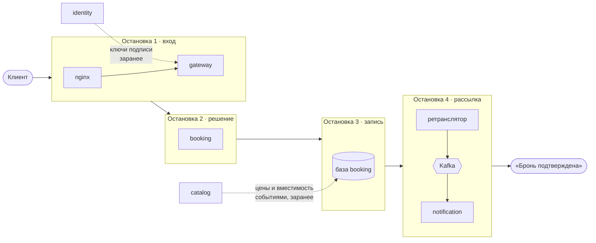
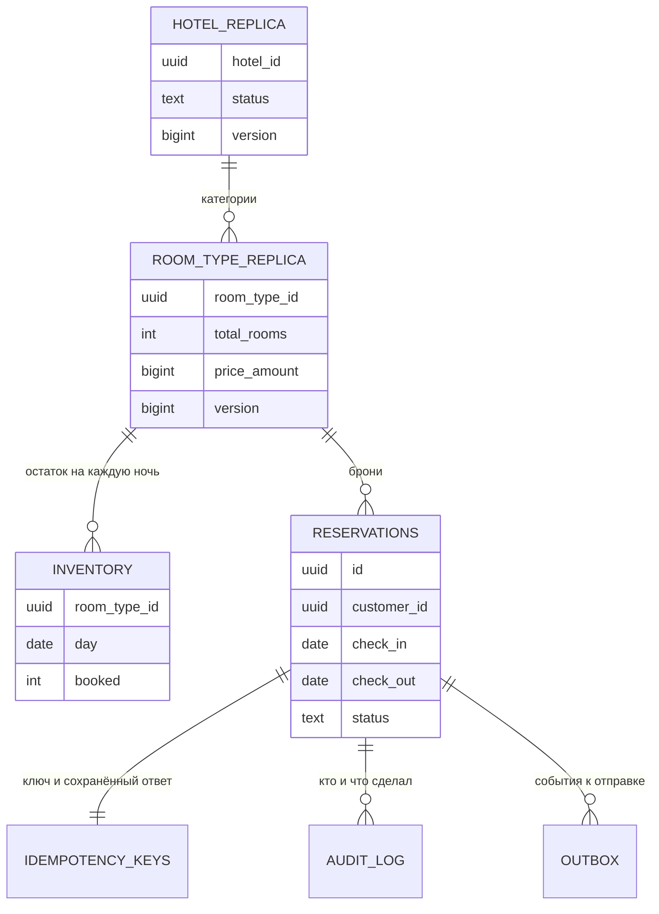
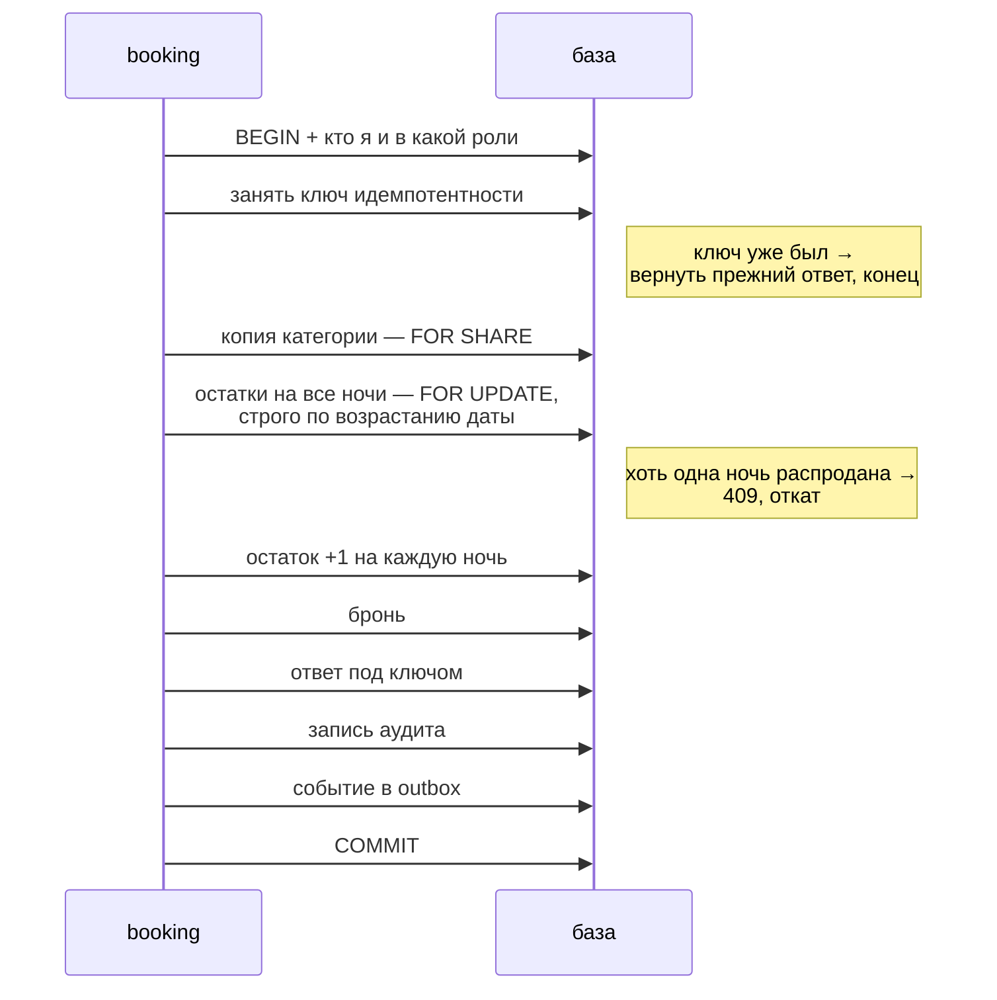
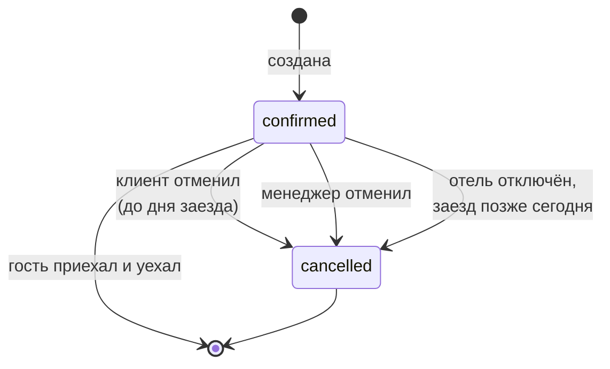
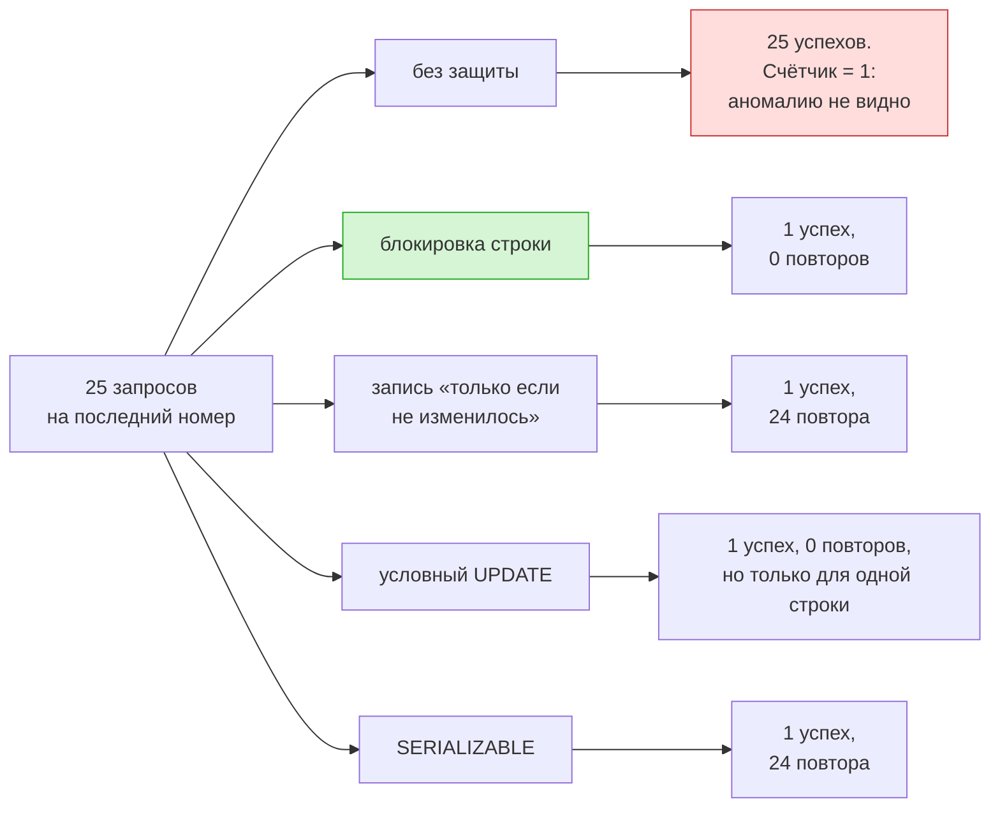
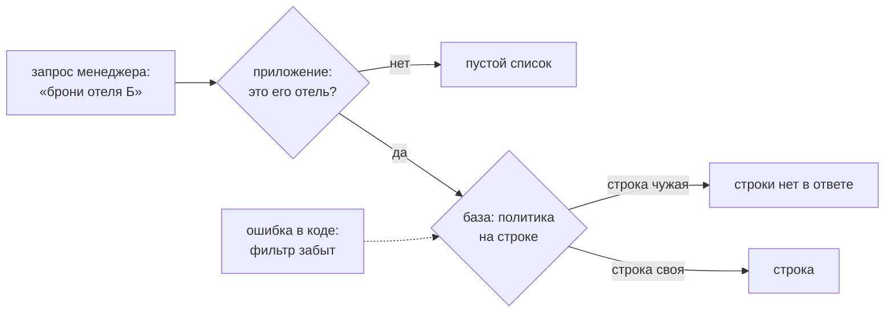
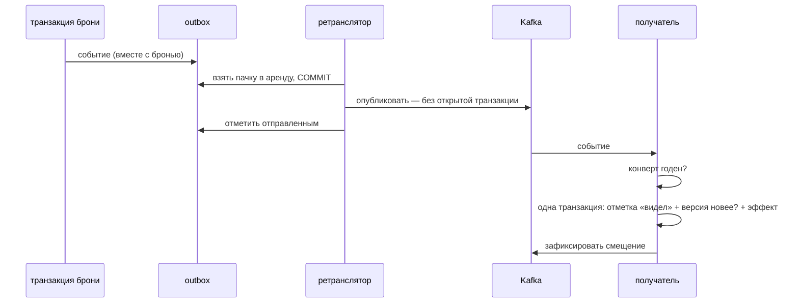
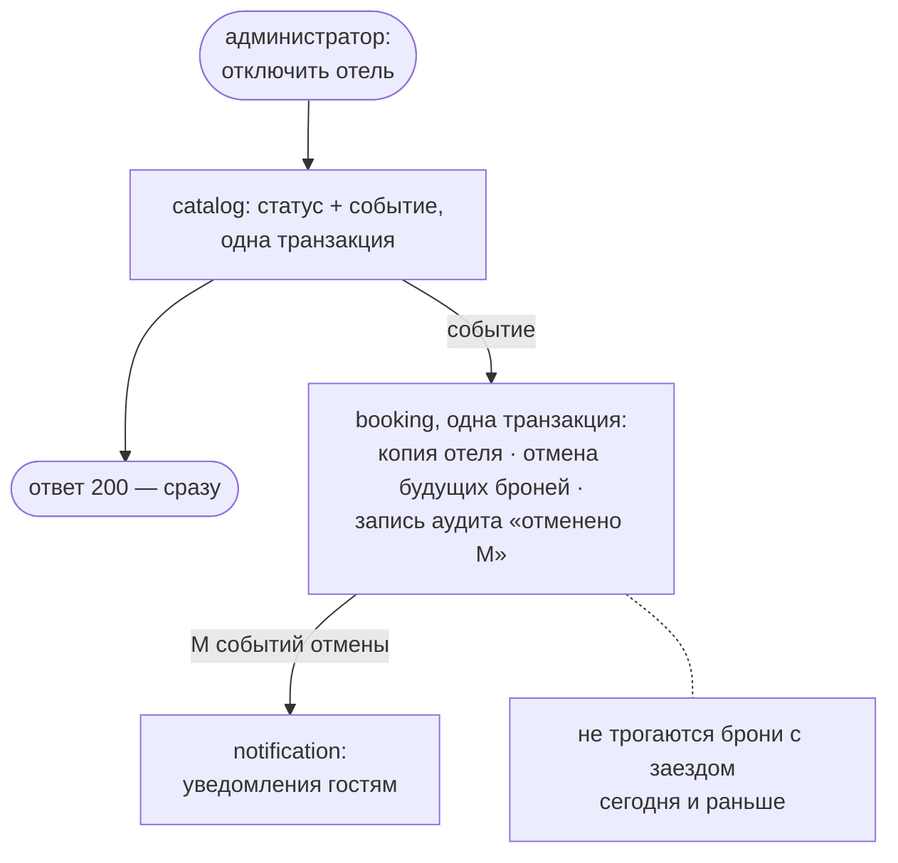
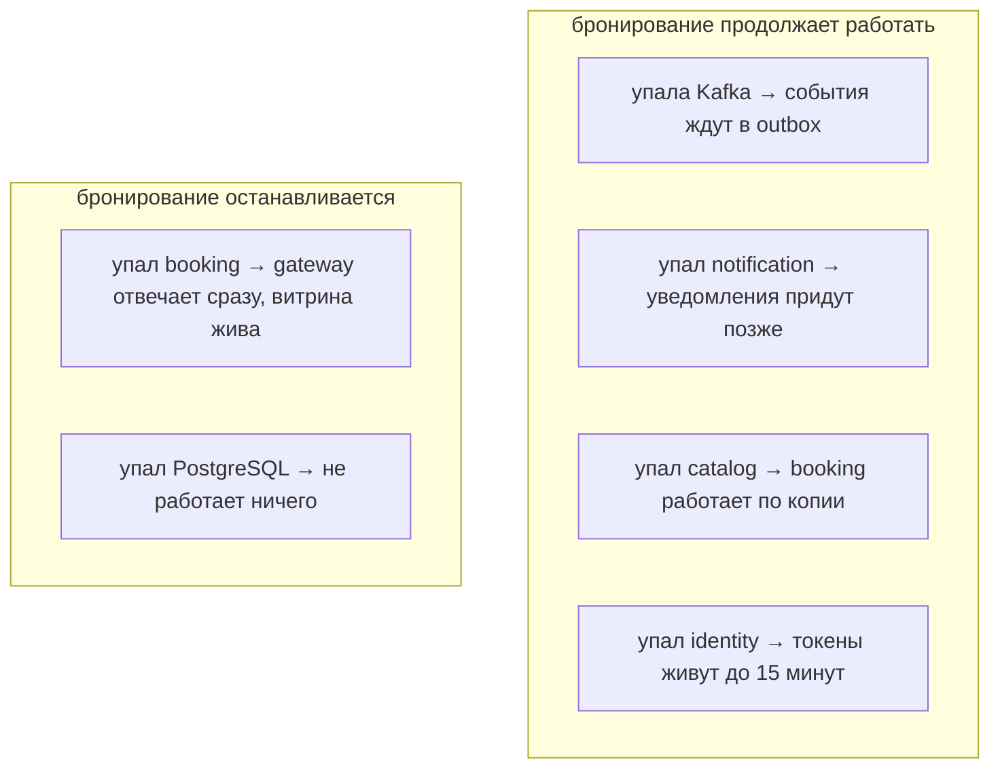

# TourFlow: путеводитель

Документ читается в три захода. Сначала — одна бронь от нажатия кнопки до уведомления: по дороге видны все части системы. Затем — четыре обещания, которые система даёт, и чем каждое держится. В конце — счёт: чем за это заплачено и что уже ломалось.

За подробностями: [TRADEOFFS.md](TRADEOFFS.md) (121 запись, номера **T..** и **D..** ведут туда), [TENANCY.md](TENANCY.md), [LOAD.md](LOAD.md), [ARCHITECTURE.md](ARCHITECTURE.md).

**Предметная область за минуту.** Отель — граница арендатора, у него есть менеджеры. Категория — «Стандарт двухместный, 12 штук»: продаётся вместимость, а не номер 305. Бронь — категория на ночи `[заезд, выезд)`. Остаток — сколько номеров категории продано на одну ночь. Клиент бронирует, менеджер ведёт свои отели, администратор — все отели, но сам не бронирует.

## Словарь

Все термины документа. Читать подряд не обязательно: встретилось непонятное слово — оно здесь.

**Названия в этой системе**

| Слово | Что значит |
|---|---|
| identity | сервис входа: пользователи, роли, выдача пропусков |
| catalog | сервис отелей: описания, категории номеров, цены, менеджеры |
| booking | сервис бронирования: свободные номера, брони, журнал действий |
| notification | сервис уведомлений гостям |
| `Idempotency-Key` | заголовок запроса, в котором передаётся ключ идемпотентности (см. ниже) |
| Полуинтервал `[заезд, выезд)` | ночи считаются от дня заезда включительно до дня выезда не включая: день выезда уже свободен |
| Овербукинг | намеренная продажа большего числа номеров, чем есть, в расчёте на отмены. Здесь запрещён |
| Генератор нагрузки (loadgen) | программа, которая изображает много одновременных покупателей для замера |
| Сверка | фоновая проверка раз в час: совпадают ли счётчики проданных номеров с реальными бронями |

**Общее устройство**

| Слово | Что значит |
|---|---|
| Сервис, микросервис | отдельная программа со своей задачей. Система собрана из нескольких таких программ, которые общаются по сети |
| Монолит | противоположность: вся система — одна программа |
| Арендатор (tenant) | тот, чьи данные надо отделять от чужих. Данные разных арендаторов лежат рядом, но видеть друг друга не должны |
| Gateway, шлюз | программа на входе. Все запросы снаружи идут через неё: она проверяет, кто пришёл, и передаёт запрос нужному сервису |
| SPA | сайт, который загружается один раз и дальше сам подгружает данные, не перезагружая страницу |
| nginx | веб-сервер: раздаёт файлы сайта и пересылает запросы к шлюзу |
| REST, HTTP-запрос | обычный способ общения по сети: запрос «дай/создай/измени» и ответ с кодом |
| Коды ответа | `200`/`201` — успех (201 — создано новое), `202` — принято, ещё обрабатывается, `409` — конфликт (например, номеров нет), `429` — слишком много запросов, `401` — не вошёл, `503` — сервис сейчас недоступен |
| Синхронный вызов | один сервис спрашивает другой и ждёт ответа. Если второй лежит — первый тоже не может работать |
| Асинхронно | без ожидания: отправил сообщение и пошёл дальше, получатель обработает позже |
| JWT, токен | электронный пропуск с подписью. Его выдают при входе, и каждый сервис может проверить подпись сам, никого не спрашивая |
| Refresh-токен | долгий пропуск, по которому выдают новый короткий |
| Асимметричная подпись | подписывает один ключ (секретный), проверяет другой (открытый). Проверять могут все, выпускать — только identity |
| Проекция | отдельная таблица, заранее подготовленная под конкретный запрос |
| `readyz` | адрес, по которому сервис отвечает «готов принимать запросы» или нет |

**Данные и база**

| Слово | Что значит |
|---|---|
| PostgreSQL | база данных, в которой всё хранится |
| Схема базы | отдельный «раздел» внутри одной базы со своими таблицами и правами |
| Владение данными | правило: таблицу меняет только один сервис — её владелец |
| Реплика, копия | своя копия чужих данных. Сервис хранит у себя то, что ему нужно, чтобы не спрашивать владельца каждый раз |
| Событие-снимок | сообщение «вот текущее состояние объекта целиком», а не «вот что изменилось» |
| Версия, ревизия | номер, который растёт при каждом изменении объекта. По нему видно, какое сообщение новее |
| Согласованность в конечном счёте | копии догоняют оригинал не мгновенно, а через секунду-другую |
| Денормализация | хранить одно и то же в двух местах ради скорости (например, название отеля прямо в брони) |
| Индекс | «оглавление» таблицы, чтобы база находила строки быстро |
| Миграция | скрипт, который создаёт или меняет таблицы |
| Пул соединений | заранее открытые подключения к базе, которые запросы берут по очереди |
| Кэш | временная память: ответ запомнили, чтобы не спрашивать снова |
| Инвариант | правило, которое должно выполняться всегда. Например, «продано не больше, чем есть» |

**Транзакции и одновременная работа**

| Слово | Что значит |
|---|---|
| Транзакция | несколько изменений, которые происходят все вместе или ни одно |
| COMMIT / откат | `COMMIT` — зафиксировать транзакцию; откат — отменить всё, что она успела сделать |
| Локальная транзакция | транзакция внутри одной базы. Надёжная и простая |
| Распределённая транзакция, 2PC | попытка сделать «всё или ничего» сразу в нескольких базах. Сложно и хрупко, поэтому её избегают |
| Гонка | два запроса одновременно делают одно и то же и мешают друг другу |
| Блокировка строки, `FOR UPDATE` | запрос «запирает» строку: остальные ждут, пока он закончит |
| `FOR SHARE` | мягкая блокировка: читать строку можно многим, менять — никому, пока читают |
| Взаимная блокировка (deadlock) | двое заперли по строке и каждый ждёт строку другого. Никто не двигается |
| Уровень изоляции | насколько строго база отделяет одновременные транзакции друг от друга |
| READ COMMITTED | обычный уровень: транзакция видит всё, что уже зафиксировали другие |
| SERIALIZABLE | самый строгий уровень: результат такой, будто транзакции шли строго по очереди. Если так не выходит, база отменяет одну из них, и её надо повторить |
| Оптимистичная запись, CAS | «запиши, только если с момента чтения ничего не поменялось». Не вышло — повтори |
| Ключ идемпотентности | случайный номер, который клиент прикладывает к запросу. Повтор с тем же номером не создаёт вторую бронь или оплату, а возвращает прежний ответ |
| Идемпотентный | такой, что повтор ничего не меняет |

**Сообщения между сервисами**

| Слово | Что значит |
|---|---|
| Событие | сообщение «случилось то-то», которое сервис рассылает остальным |
| Kafka, брокер | программа-почта: принимает сообщения и хранит их, пока получатели не заберут |
| Тема (topic) | «почтовый ящик» в Kafka для одного вида сообщений |
| Раздел, партиция | часть темы. Внутри раздела сообщения идут строго по порядку |
| Смещение (offset) | закладка получателя: до какого сообщения он уже дочитал |
| Outbox | таблица «исходящие». Сообщение кладётся туда той же транзакцией, что и основное изменение, а в Kafka уходит потом |
| Ретранслятор | фоновый процесс, который забирает сообщения из outbox и отправляет в Kafka |
| Аренда | ретранслятор помечает сообщения «взял на 30 секунд». Упал — метка истечёт, и их возьмёт другой |
| Inbox | таблица «уже получено». По ней получатель узнаёт повторное сообщение и не обрабатывает его второй раз |
| «Не меньше одного раза» | гарантия доставки: сообщение точно дойдёт, но может прийти дважды |
| Конверт события | служебная обёртка сообщения: номер, тип, время, версия формата |
| DLQ, карантин | отдельная очередь для сообщений, которые невозможно обработать |
| Временная / постоянная ошибка | временная пройдёт сама (база недоступна), постоянная — нет (сообщение испорчено) |
| Хореография | сервисы не командуют друг другом: каждый реагирует на события сам |
| Оркестрация | один сервис ведёт процесс по шагам и говорит остальным, что делать |
| Сага | длинный процесс из нескольких шагов в разных системах. Если шаг не удался, предыдущие отменяются |
| Компенсация | действие, отменяющее уже сделанный шаг (вернуть деньги, отменить бронь) |

**Защита**

| Слово | Что значит |
|---|---|
| RLS, защита строк | правило внутри самой базы: «эту строку видит только её хозяин». Работает, даже если в программе забыли проверку |
| Политика | одно такое правило RLS |
| `FORCE` | настройка, при которой политика действует даже на владельца таблицы |
| Контекст | база должна знать, от чьего имени запрос. Сервис сообщает ей это в начале каждой транзакции |
| Роль базы | учётная запись в базе со своим набором прав |
| Владелец | роль, которой принадлежат таблицы; может менять и правила |
| Роль данных | роль, под которой идут запросы пользователей: читать и писать строки можно, менять правила — нельзя |
| Триггер | код внутри базы, который срабатывает сам при изменении таблицы |
| Аудит | журнал «кто, что и когда сделал». В него можно только добавлять |
| Прерыватель (circuit breaker) | если сервис не отвечает, запросы к нему перестают отправлять и сразу возвращают ошибку — чтобы не копить очередь |
| Лимит запросов | ограничение, сколько запросов можно сделать за минуту |

**Проверки и замеры**

| Слово | Что значит |
|---|---|
| p95, p99 | время, в которое укладываются 95 (99) запросов из 100. Показывает не среднее, а «почти худший» случай |
| Медиана | середина: половина замеров лучше, половина хуже |
| SLO, цель | обещанный показатель: например, «p95 брони меньше 100 мс» |
| мс | миллисекунда, тысячная доля секунды |
| Модульный тест | проверка одной функции отдельно от всего |
| Интеграционный тест | проверка кода вместе с настоящей базой или Kafka |
| Сквозной сценарий (e2e) | проверка всей системы целиком, как её видит пользователь |
| Архитектурный тест | проверка, что сервисы не используют код друг друга |
| Детектор гонок | инструмент Go, который ловит ошибки одновременного доступа к памяти |
| Отрицательный тест | проверка, что запрещённое действительно запрещено |

---

# Часть I. Одна бронь, от клика до уведомления

> **Простыми словами.** Проследим за одной бронью от нажатия кнопки до письма гостю. По пути встретятся все программы системы.

Два сервиса на схеме стоят сбоку, и это главное в устройстве системы: **в момент брони ни identity, ни catalog не вызываются**. Всё, что от них нужно, приехало заранее.

## Остановка 1. Вход: gateway

> **Простыми словами.** На входе стоит программа-привратник. Она проверяет электронный пропуск и следит, чтобы никто не слал слишком много запросов. Сама ничего не решает.

Клиент шлёт `POST /api/reservations` с токеном и заголовком `Idempotency-Key`.

- Gateway проверяет подпись токена **локально**, по публичному ключу identity. Ключи кэшируются; если identity лежит, выданные токены работают дальше (T56, T59).
- Здесь же лимит запросов и прерыватель на каждый сервис. Перегрузка получает отказ, а не место в очереди (T52, T58).
- Бизнес-логики в gateway нет вообще (T06).

## Остановка 2. Решение: booking

> **Простыми словами.** Сервис бронирования решает, можно ли продать номер. Цены и число номеров ведёт другой сервис, но бронирование его не спрашивает — у него есть своя копия этих данных.

Booking проверяет токен ещё раз сам (T55) и решает, можно ли бронировать. Для решения ему нужны цена, вместимость и статус отеля — данные каталога. Он не спрашивает catalog, а читает **свою копию**.

Всё на этой схеме — одна база, и владеет ею один сервис. Две верхние таблицы — копии каталога: писать в них может только обработчик событий, обычные запросы их только читают (T09, T112).

Цена копии: она отстаёт примерно на секунду. В это окно можно забронировать по старой цене. Правило простое — официальная цена та, что видел booking (T18).

## Остановка 3. Запись: одна транзакция

> **Простыми словами.** Сервис запирает строки со свободными номерами, проверяет, что место есть, и делает пять записей разом. Либо появляются все пять, либо ни одной.

Пять последних записей появляются вместе или не появляются вовсе. Клиент получает `201` сразу после `COMMIT` и ничего больше не ждёт (T17, T30).

## Остановка 4. Рассылка

> **Простыми словами.** Письмо гостю отправляется уже после того, как бронь оформлена. Если рассылка сломана, бронь всё равно есть.

Ретранслятор забирает событие из outbox и публикует в Kafka — уже вне транзакции. Notification получает его, проверяет, что не видел раньше, и создаёт уведомление. Если notification лежит, бронь всё равно создана; уведомление придёт позже.

## Что дальше происходит с бронью

> **Простыми словами.** У брони всего два состояния: действует или отменена. Удалить её нельзя.

Состояний два. Отмена возвращает остаток той же транзакцией и тоже порождает событие. Удалить бронь нельзя никому: у роли, под которой идут запросы, права на удаление нет.

---

# Часть II. Четыре обещания

> **Простыми словами.** Система обещает четыре вещи. Ниже — чем каждое обещание обеспечено и где его предел.

## Обещание 1. Не продадим больше, чем есть номеров

> **Простыми словами.** Когда двое одновременно берут последний номер, один ждёт, пока второй закончит. Мы сравнили пять способов защиты и выбрали «запирать строку».

Это правило связывает несколько строк, поэтому его держат три слоя сразу.

| Слой | Что делает |
|---|---|
| Схема | остаток не бывает отрицательным; один ключ — одна бронь |
| Транзакция | проверка и «+1» идут под блокировкой строк остатков (T31) |
| Фоновая сверка | раз в час сравнивает остатки с бронями и пишет расхождения; сама ничего не чинит (T117) |

Почему именно блокировка. Опыт: 25 транзакций одновременно берут единственный свободный номер.

Бронь на неделю меняет семь строк. Блокировка расширяется на это естественно, условный `UPDATE` — нет, а два оставшихся способа платят повторами. Блокировки берутся по возрастанию даты, поэтому две пересекающиеся брони не зависают друг на друге (T34).

Цена: на одной популярной категории брони встают в очередь. Замер — 480–560 броней в секунду, дальше растёт только время ответа.

**Двойной клик** закрыт отдельно: без `Idempotency-Key` команда не принимается, а повтор с тем же ключом возвращает сохранённый ответ и код `200` вместо `201` (T37, T116).

## Обещание 2. Не покажем чужого

> **Простыми словами.** Чужие брони не увидит никто. Проверок две: в программе и в самой базе. Если программист забудет первую, сработает вторая.

Чужое здесь двух видов: брони другого клиента и брони другого отеля. Строки всех лежат в общих таблицах (T113), поэтому защита двойная, и слои не знают друг о друге.

Нижняя стрелка — смысл второго слоя: если в новом запросе забыть условие, база вернёт пустоту, а не чужие брони.

Чтобы второй слой нельзя было отключить, у каждого сервиса две роли базы (T111):

| Роль | Кто под ней работает | Что может |
|---|---|---|
| владелец | миграции, ретранслятор, обработчик событий каталога, сверка | всё в своей базе |
| роль данных | все запросы пользователей | читать и писать строки; **не может** снять политику, удалить триггер аудита, прочитать outbox, изменить копию каталога, удалить бронь |

Проверено с двух сторон: один тест выключает политики и убеждается, что приложение само не отдаёт чужое; другой идёт прямым SQL мимо сервиса.

Что этим **не** закрыто:

- политика верит контексту, который ставит код сервиса; код, нарочно подставивший чужого пользователя, увидит чужое;
- владелец базы может снять защиту, а он работает в том же процессе;
- остатки и копии каталога политиками не закрыты — это публичные данные витрины, они защищены правами;
- журнал аудита есть только в booking; кто назначил менеджера, по базе не узнать (T124).

## Обещание 3. Не потеряем событие

> **Простыми словами.** Сообщение о брони записывается вместе с самой бронью, а отправляется потом. Оно может прийти дважды, но не может потеряться; получатель умеет узнавать повторы.

Запись в базу и запись в брокер нельзя сделать одной операцией. Поэтому событие сначала кладётся в таблицу той же транзакцией, что и бронь, а в брокер уходит потом.

Гарантия — «не меньше одного раза», поэтому получатель обязан выдерживать повторы (T21).

| Что случилось | Чем кончится |
|---|---|
| Ретранслятор упал после публикации | аренда истечёт, событие уйдёт ещё раз; получатель узнает дубль |
| Получатель упал до фиксации смещения | событие придёт снова; отметка «видел» его отсечёт |
| Старое событие пришло после нового | версия не новее сохранённой — эффекта нет (T22) |
| База получателя лежит | повтор с паузой сколько потребуется; очередь стоит, но ничего не пропадает (T27) |
| Сообщение битое или незнакомой версии | в карантин, очередь идёт дальше |

Последние две строки — разные правила, и это принципиально: **повтор лечит временную ошибку и не лечит постоянную**.

### Где это видно в деле: отключение отеля

> **Простыми словами.** Администратор закрывает отель. Сервис отелей рассылает сообщение, сервис бронирования сам отменяет будущие брони, рассылка сама пишет гостям. Никто никем не командует.

Единственный процесс, который идёт через несколько сервисов.

Координатора нет: каждый сервис реагирует сам (T23). Администратор получает ответ сразу, а итог — «отменено M броней» — остаётся записью в аудите отеля. Нет записи — значит, событие ещё не обработано (T121).

Гостя, который уже едет или живёт, алгоритм не выселяет: это решение отеля (T24).

## Обещание 4. Сбой соседа не остановит бронирование

> **Простыми словами.** Почти любой сервис может упасть — бронирование продолжит работать. Исключения два: само бронирование и общий сервер базы.

Последняя строка — честная слабость: база у каждого сервиса своя, но сервер один (T08).

Между сервисами ровно один синхронный вызов: catalog спрашивает identity, существует ли пользователь, когда назначают менеджера (T29). На пути брони его нет.

## Чем обещания подтверждены

> **Простыми словами.** Автоматические проверки и замер скорости под нагрузкой. После замера всё в базе пересчитано — расхождений нет.

**Тесты.** 57, все с детектором гонок: 37 на настоящем PostgreSQL под ролью данных, 6 на настоящей Kafka, 12 модульных, 2 архитектурных. Сквозной сценарий через gateway — 42 проверки.

**Замер.** Через весь путь, с работающей рассылкой. 18 прогонов на заново созданных базах, ни один не выброшен; в таблице медианы трёх повторов.

| | 1 клиент | 8 клиентов | 32 клиента |
|---|---:|---:|---:|
| Чтение доступности, p95 | 1.4 мс | 8.3 мс | 35.9 мс |
| Бронь, p95 | 5.6 мс | 26.5 мс | 61.7 мс |
| Бронь в одну категорию, p95 | 5.8 мс | 34.1 мс | 87.3 мс |
| Броней в секунду (обычная работа) | 163 | 291 | 321 |

Цели — p95 чтения до 50 мс и записи до 100 мс — выполнены; у «одной категории» запас малый. Упирается всё в процессор стенда: два ядра заняты на 95 %.

**Сверка после замера.** 150 230 броней в прогонах — и ровно 150 230 ключей, записей аудита и событий в базе. Расхождений остатков с бронями — ноль.

Замер оптимистичен: одна машина, прогретый кэш. Цифры годятся, чтобы сравнивать решения между собой.

---

# Часть III. Счёт

## Чем заплачено

> **Простыми словами.** У каждого решения есть цена. Здесь решения сгруппированы по тому, чем именно заплатили: задержкой, скоростью, сложностью или риском.

Решения сгруппированы по тому, **какой монетой** за них заплачено. В скобках — что получили взамен.

**Платим задержкой согласованности**

- Копия каталога в booking отстаёт на секунду (бронь не зависит от catalog) — T09, T18. *Пересмотреть, когда цены начнут меняться каждую минуту.*
- Итог отключения отеля виден не сразу и только в аудите (администратор не ждёт, сервисы не знают друг о друге) — T23. *Пересмотреть, когда появится шаг, способный отказать, например возврат денег.*
- Уведомление может опоздать (бронь не ждёт рассылку) — T30.

**Платим пропускной способностью**

- Очередь на популярной категории (нет повторов и нет ложных отказов) — T31. *Пересмотреть при распродажах на тысячи броней в секунду.*
- Очередь событий стоит, пока база получателя лежит (ни одно событие не теряется) — T27.
- Транзакция с контекстом на каждый запрос к защищённым таблицам (забытый фильтр не раскрывает чужое) — T39.

**Платим сложностью**

- Пять процессов, брокер, сеть (каждая граница сервисов обоснована) — T01. Для турфирмы с тысячей броней в день это избыточно; так сделано, чтобы на одной области показать весь курс.
- Две роли и два пула на сервис (код запросов не может снять защиту) — T111.
- Получатель обязан узнавать дубли и старые версии (событие не теряется) — T21, T22.
- Booking — самый толстый сервис: и остатки, и брони (главное правило держит одна транзакция) — T02.

**Платим риском**

- Один сервер PostgreSQL (система поднимается одной командой) — T08.
- Общие таблицы для всех отелей: ошибка в политике открыла бы всё сразу (одна схема, одна миграция) — T113.
- Сверка остатков не чинит расхождения сама (дефект не будет молча скрыт) — T117.

## Чего нет и не обещано

> **Простыми словами.** Что сознательно не делали.

Оплаты — она превратила бы бронь в сагу с банком. Поиска свободных номеров сразу по всем отелям. Настоящей почты и SMS. Метрик и трассировки. Повторной подачи событий из карантина. Овербукинга, часовых поясов отелей, сброса пароля. Репликации и резервных копий. Полный список с тем, что потребуется, — раздел K в TRADEOFFS.md.

## Что уже ломалось

> **Простыми словами.** Ошибки, которые нашли в процессе, сгруппированные по тому, чему они научили.

16 дефектов записаны в журнале полностью. Здесь они разложены по тому, **чему научили**.

**Документ обещал больше, чем делал код.**
В миграции было написано, что аудит не может изменить «даже владелец», а владелец мог удалить триггер (D6). Документы говорили о двух уровнях защиты списков менеджера — работал один (D10). Говорили «роль данных у каждого сервиса» — identity ходил под владельцем (D14). Первый паспорт нагрузки утверждал, что приложены все прогоны, а один был стёрт вручную (D13).
*Вывод: каждое утверждение в документе теперь привязано к тесту или к числу, которое можно пересчитать по базе.*

**Защиту обходили прямым SQL.**
В аудит можно было записать от чужого имени (D7), потом — в журнал чужого отеля (D9). Роль данных могла вписать себя в таблицу менеджеров (D11), поменять цену в копии каталога (D15), объявить себя служебным процессом или подменить таблицу временной (D16).
*Вывод: отрицательные тесты идут мимо сервиса, под той же ролью, что и запросы пользователей.*

**Отказ инфраструктуры превращался в потерю данных.**
Сбой базы на пару секунд отправлял корректное событие в карантин, а при недоступном карантине оно исчезало (D4). Ретранслятор держал блокировку всё время сетевого вызова (D5). Получатель, подключившийся раньше появления темы, молча ничего не получал (D1).
*Вывод: все сценарии сбоя доставки проверяются на настоящем брокере.*

**Порядок проверок оказался важен.**
Повтор запроса после полуночи получал «дата прошла» вместо сохранённого ответа: даты проверялись раньше ключа (D12). Старые ключи без сохранённого ответа ломали повтор (D8).
*Вывод: ключ идемпотентности проверяется первым.*

Остальное — мелочи интерфейса и тестов (D2, D3).

---

# Если спросят

> **Простыми словами.** Короткие ответы на вероятные вопросы преподавателя.

**Зачем столько сервисов?** Честный ответ — для курса; бизнесу такого размера хватило бы одного приложения с теми же модулями. Но каждая граница названа и обоснована: остатки с бронями вместе из-за транзакции, рассылка отдельно из-за изоляции сбоев, каталог отдельно из-за разного характера нагрузки (T01–T05).

**Где распределённая транзакция?** Нигде, и это намеренно. Бронь целиком локальная. Через несколько сервисов идёт только отключение отеля, и оно собрано из локальных транзакций и событий.

**Двое берут последний номер одновременно?** Один получает бронь, второй — `409`. Тест на 25 одновременных запросов.

**Менеджер увидит брони чужого отеля?** Нет: его остановит приложение, а если в приложении ошибка — база. Предел защиты: база верит контексту, который ей передал сервис.

**Событие может пропасть?** Нет. Оно записано вместе с бронью, а получатель повторяет временные ошибки без ограничения.

**Что сделали бы дальше?** Поиск по датам через отдельную проекцию, метрики, повторную подачу из карантина, оплату.

---

# Карта кода

| Что ищем | Где |
|---|---|
| Правила предметной области | `backend/internal/<сервис>/domain` |
| Сценарии и транзакции | `backend/internal/<сервис>/app` |
| SQL и политики | `backend/internal/<сервис>/store`, `migrations` |
| Outbox, получатель, проверка конверта | `backend/internal/platform/messaging` |
| Роли базы, контекст | `backend/internal/platform/pg` |
| Запрет импорта между сервисами | `backend/arch_test.go` |
| Генератор нагрузки | `backend/tools/loadgen`, `scripts/load/run_all.sh` |
| Сквозной сценарий | `scripts/e2e.sh` |
| Сырые выводы тестов и замеров | `docs/evidence/raw` |
